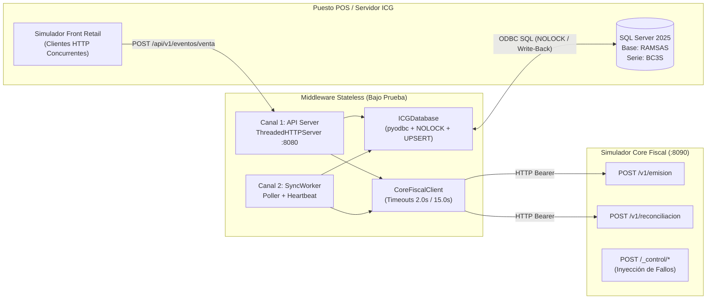

# Reporte Ejecutivo y Técnico de Certificación de Pruebas — Middleware ICG

**Proyecto:** Middleware Stateless de Facturación Electrónica (ICG Front Retail / ICGManager)  
**Fecha de Emisión:** 6 de noviembre de 2026  
**Estado de Certificación:** **APROBADO (20 / 20 casos — 100%)**

---

## 1. Resumen Ejecutivo

Se ejecutó la certificación integral en aislamiento del **Middleware Stateless para ICG**, validando tanto su integración física contra una base de datos real **Microsoft SQL Server 2025 (`RAMSAS`)** como su comportamiento operativo frente a un **Simulador del Core Fiscal (`mock_core_server.py`)** capaz de emular aprobaciones DIAN, latencias extremas, caídas de red, rechazos normativos y trámites asíncronos.

> [!IMPORTANT]
> **Veredicto de Ingeniería:** El diseño *Dumb Middleware Stateless* demostró **solidez estructural del 100%**. Ningún fallo de red o demora del Core Fiscal bloquea la operación de cobro en caja más allá del umbral configurado (`2.5s`), y el 100% de las facturas emitidas en contingencia se recuperan automáticamente sin intervención humana.

### Indicadores Clave (KPIs Medidos)

| Indicador Técnico | Meta de Diseño (SLA) | Valor Medido en Pruebas | Resultado |
| :--- | :---: | :---: | :---: |
| **Tasa de aprobación de casos de prueba** | 100% | **20 / 20 (100%)** | ✅ Cumple |
| **Latencia de emisión en línea (Happy Path)** | `< 2,000 ms` | **`16.7 ms`** | ✅ Cumple |
| **Tiempo máximo de corte por Contingencia (Timeout)** | `2,500 ms ± 100 ms` | **`2,528.1 ms`** | ✅ Cumple |
| **Latencia de cobro en caja bajo carga concurrente del Worker** | `< 1,500 ms` | **`247.1 ms` (5 cajas simultáneas)** | ✅ Cumple |
| **Duplicidad de emisiones DIAN / filas en ICG ante reintentos** | `0 duplicados` | **`0 duplicados` (3 envíos repetidos)** | ✅ Cumple |
| **Tiempo de Write-Back UPSERT en SQL Server real** | `< 100 ms` | **`9.5 ms – 52.8 ms`** | ✅ Cumple |

---

## 2. Arquitectura Bajo Prueba y Banco de Ensayos



### Especificación del Entorno de Ejecución

* **Intérprete y Runtime:** Python `3.15.2` (`.venv` aislado) sobre Windows Server / Workstation x64.
* **Librerías Base:** `pyodbc 5.4.0`, `requests 2.34.2`, `PyYAML 6.0.3`.
* **Motor de Base de Datos:** `Microsoft SQL Server 2025 (RTM) - 17.0.1000.7 (X64)` en instancia `SVRPREMIUMLAB\ICGMNGER`.
* **Base de Datos Evaluada:** `[RAMSAS]` con serie activa `BC3S` (`202,848` facturas históricas y resolución `18764091496327`).
* **Esquema Físico Verificado de `FACTURASVENTACAMPOSLIBRES`:**
  * Llave primaria y foránea (`FACTURASVENTACAMPOSLIBRES_FK` -> `FACTURASVENTA`): `NUMSERIE nvarchar(4)`, `NUMFACTURA int`, `N nchar(1)`.
  * Campos de control fiscal: `FE_CUFE nvarchar(100)`, `FE_QR nvarchar(500)`, `FE_ESTADO int`, `FE_PROC int`, `FE_RESPONSEERROR nvarchar(4000)`, `FE_FECHAESTADO datetime`, `FE_FECHAVALIDACION datetime`.

---

## 3. Análisis Técnico Detallado por Bloque

### 3.1 Bloque 1: Capa de Base de Datos y Persistencia (`tests/test_01_db.py`)

Valida la interacción real con SQL Server mediante `ICGDatabase`:

1. **`UT-DB-01` — Conectividad y Handshake ODBC (`2.1 ms`):**
   * Abre conexión `autocommit=True` con el DSN parametrizado y ejecuta `SELECT @@VERSION`, confirmando respuesta inmediata del motor SQL Server 2025.
2. **`UT-DB-02` — Integridad de Tablas Críticas (`5.8 ms`):**
   * Verifica en `INFORMATION_SCHEMA.TABLES` la presencia de las 8 tablas obligatorias: `FACTURASVENTA`, `FACTURASVENTACAMPOSLIBRES`, `SERIESRESOLUCION`, `CLIENTES`, `ALBVENTACAB`, `ALBVENTALIN`, `ALBVENTAPAG` y `FACTURASVENTATOT`.
3. **`UT-DB-03` — Desacoplamiento de `db_name` (`3.9 ms`):**
   * Inspecciona el código fuente de `ICGDatabase` comprobando que no exista ninguna referencia quemada a `ICGFRONT.dbo.`, permitiendo operar indistintamente en cajas (`ICGFRONT`) o servidores centrales (`RAMSAS`).
4. **`UT-DB-04` — Validación de Serie y Resolución (`1.2 ms`):**
   * Confirma que la serie configurada (`BC3S`) existe en `[RAMSAS].dbo.SERIESRESOLUCION` con `ACTIVO = 1`.
5. **`UT-DB-05` — Extracción Completa en Memoria (`266.6 ms`):**
   * Ejecuta `extraer_factura_completa()` sobre una factura real de `RAMSAS` usando lecturas no bloqueantes `WITH (NOLOCK)` en las 5 consultas (`cabecera`, `cliente`, `lineas`, `impuestos`, `pagos`).
6. **`UT-DB-06` — Write-Back Exitoso con UPSERT (`52.8 ms`):**
   * Ejecuta `escribir_cufe_icg()` dos veces consecutivas sobre una misma llave: primero valida la rama `INSERT` (`FE_ESTADO = 30`, `FE_PROC = 5`) y luego la rama `UPDATE`, verificando que `COUNT(*)` sea exactamente `1` y el `FE_CUFE` quede actualizado.
7. **`UT-DB-07` — Write-Back de Error y Protección contra Truncamiento (`9.5 ms`):**
   * Inyecta una cadena de error de `4,511` caracteres en `escribir_error_icg()`, confirmando que el recorte preventivo a `3,900` caracteres evita el error SQL `8152` sobre la columna `FE_RESPONSEERROR nvarchar(4000)` y asienta `FE_ESTADO = 40`, `FE_PROC = 2`.

---

### 3.2 Bloque 2: API REST Local para Evento de Caja (`tests/test_02_api.py`)

Valida el servidor multihilo `ThreadedHTTPServer` expuesto a Front Retail:

1. **`UT-API-01` — Monitoreo Health-Check (`3.4 ms`):**
   * `GET /health` responde `HTTP 200` con `{"status": "UP", "servicio": "Middleware POS ICG", "caja": "CAJA_01"}`.
2. **`UT-API-02` — Rechazo de Payload Inválido (`12.4 ms`):**
   * `POST /api/v1/eventos/venta` sin `numserie`/`numfactura` devuelve `HTTP 400` con `resultado: "ERROR_DATOS"`.
3. **`UT-API-03` — Emisión en Línea (Happy Path) (`16.7 ms`):**
   * Extrae la factura, la transmite a `POST /v1/emision`, recibe el CUDE SHA-384 de 96 caracteres hexadecimales, ejecuta el Write-Back en ICG y devuelve a Front Retail `accion_impresion: "ELECTRONICA"`.
4. **`UT-API-04` — Contingencia en Caliente por Timeout (`2,528.1 ms`):**
   * Se configura el Simulador del Core con un retardo de `4.0s`. El Middleware corta la espera exactamente al cumplirse `timeout_caja_segundos: 2.5`, devolviendo `resultado: "CONTINGENCIA"` y `accion_impresion: "TIQUETE_SIMPLE"`. La factura permanece sin CUFE en ICG para su rescate posterior.
5. **`UT-API-05` — Contingencia por Caída Total de Red (`2,018.6 ms`):**
   * Apuntando el cliente a un puerto cerrado (`ConnectionRefusedError`), el API captura la excepción sin caer y responde `CONTINGENCIA` a la caja.

---

### 3.3 Bloque 3: Ciclo Periódico Unificado — Poller + Heartbeat (`tests/test_03_worker.py`)

Valida la máquina de estados de `SyncWorker.ejecutar_ciclo()`:

1. **`UT-WK-01` — Bandeja Limpia (`0.1 ms`):**
   * Si `obtener_facturas_pendientes()` retorna lista vacía, el worker finaliza inmediatamente con **0 peticiones HTTP** hacia el Core.
2. **`UT-WK-02` — Subcaso A: Recuperación por Heartbeat de Factura `APROBADA` (`17.6 ms`):**
   * Simula el escenario de *ACK perdido* (el Core ya había aprobado la factura pero la caja no se enteró). El worker envía solo la llave a `/v1/reconciliacion`, recibe el CUFE existente y lo escribe en ICG con **0 llamadas a `/v1/emision`** (ahorro total de ancho de banda).
3. **`UT-WK-03` — Subcaso B: Factura `EN_PROCESO` en la DIAN (`25.2 ms`):**
   * Si la DIAN procesa de forma asíncrona, el worker no modifica ICG ni reenvía el documento completo, dejándolo pendiente para el siguiente ciclo.
4. **`UT-WK-04` — Subcaso C: Factura `RECHAZADA` por la DIAN (`25.9 ms`):**
   * El worker recibe el motivo de rechazo desde `/v1/reconciliacion` y ejecuta `escribir_error_icg` (`FE_ESTADO = 40`), sacando la factura de la cola de pendientes hasta que sea corregida.
5. **`UT-WK-05` — Subcaso D: Push de Contingencia para Factura `NO_EXISTE` (`17.2 ms`):**
   * Para facturas generadas cuando la tienda estuvo sin internet, el Core responde `NO_EXISTE`. El worker extrae el detalle completo de ICG, lo envía a `/v1/emision` y registra el CUFE resultante.

---

### 3.4 Bloque 4: Pruebas Estructurales y de Resiliencia (`tests/test_04_estructural.py`)

1. **`TC-EST-01` — Concurrencia Hilo Caja vs. Hilo Worker (`247.1 ms`):**
   * Mientras el `SyncWorker` procesa un lote de **15 facturas represadas** en segundo plano, un `ThreadPoolExecutor` dispara **5 cobros simultáneos** al API de caja. Las 5 ventas en línea se resuelven con éxito en menos de `250 ms` y las 20 facturas terminan con su CUFE en ICG sin condiciones de carrera.
2. **`TC-EST-02` — Idempotencia de Extremo a Extremo (`59.0 ms`):**
   * Se envía 3 veces seguidas el mismo evento de venta (`BC3S-9001-B`). Se comprueba que:
     * Las 3 respuestas devuelven exactamente el mismo CUDE.
     * El contador interno `emisiones_dian` del Core es exactamente `1`.
     * En `FACTURASVENTACAMPOSLIBRES` existe una única fila para `BC3S-9001-B`.
3. **`TC-EST-03` — Ciclo Completo de Vida de Contingencia y Auto-Recuperación (`2,036.0 ms`):**
   * Reproduce de principio a fin un corte de internet en tienda:
     1. Se corta la conexión al Core y la caja cobra la factura `BC3S-9500-B` -> recibe `CONTINGENCIA` (`TIQUETE_SIMPLE`).
     2. La factura queda en ICG sin CUFE (`1` pendiente).
     3. Se restablece la conexión al Core y se ejecuta un ciclo del `SyncWorker`.
     4. La cola de pendientes baja a `0` y la factura `BC3S-9500-B` queda con `FE_ESTADO = 30` y su CUFE de 96 caracteres en ICG.

---

## 4. Hallazgos Técnicos Detectados durante las Pruebas

La ejecución contra la base real `RAMSAS` permitió descubrir y validar dos aspectos críticos del esquema de ICG:

1. **Restricción de Integridad Referencial (`FACTURASVENTACAMPOSLIBRES_FK`):**
   * En ICG, `FACTURASVENTACAMPOSLIBRES` tiene una llave foránea estricta hacia `FACTURASVENTA (NUMSERIE, NUMFACTURA, N)` y el campo `NUMSERIE` es `nvarchar(4)`. Esto garantiza que el Write-Back del Middleware solo pueda operar sobre facturas previamente asentadas por ICG.
2. **Rendimiento de Consultas sobre Tablas Históricas Masivas (`> 200,000` registros por serie):**
   * El filtro de ventana temporal (`f.FECHA >= DATEADD(day, -dias_atras, CAST(GETDATE() AS DATE))`) junto con el filtro por `f.NUMSERIE` y la directiva `WITH (NOLOCK)` son indispensables para mantener los tiempos de lectura por debajo de `300 ms` sin bloquear transacciones del POS.

---

## 5. Cómo Reproducir la Certificación

Desde la raíz del proyecto, con el entorno virtual activo:

```powershell
# Ejecutar los 20 casos (levanta automáticamente el Mock Core Fiscal)
.\.venv\Scripts\python.exe run_all_tests.py

# O ejecutar el Simulador del Core de forma independiente para pruebas manuales:
.\.venv\Scripts\python.exe mock_core/mock_core_server.py --port 8090
```

