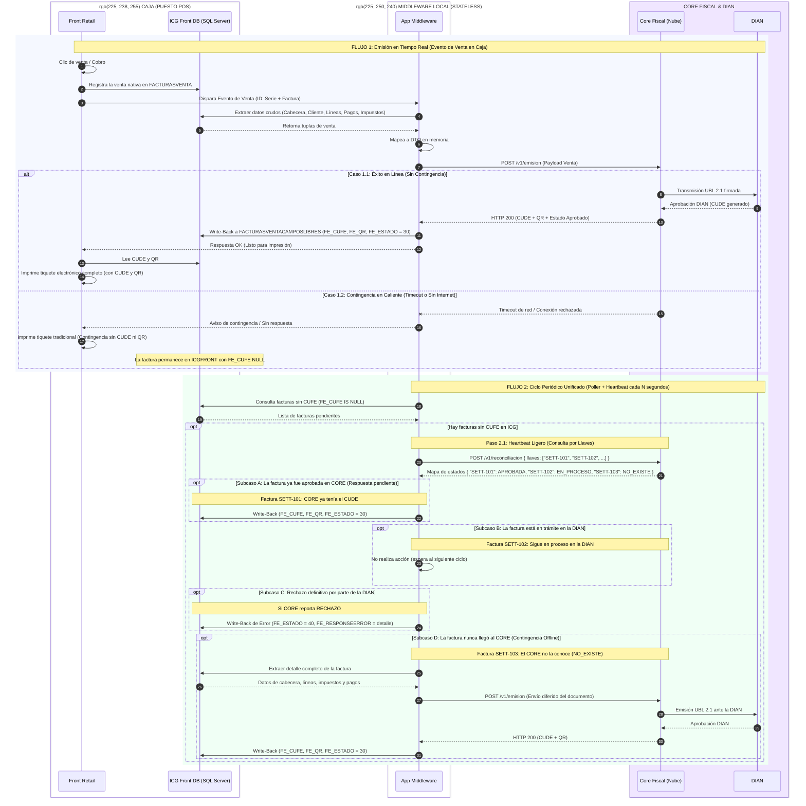

# Diagrama de Secuencia: Emisión desde Caja y Sincronización

Este documento describe la interacción entre la **Caja (Front Retail + ICG Front DB)**, el **Middleware (Stateless)** y el **Core Fiscal**, cubriendo tanto la emisión sincrónica por evento como el ciclo unificado de contingencias y sincronización (Poller + Heartbeat).

---

## Actores y Responsabilidades

| Actor | Rol en el Ecosistema | Responsabilidad Principal |
| :--- | :--- | :--- |
| **Front Retail (FR)** | Punto de Venta (Caja) | Ejecuta el cobro, dispara el evento hacia el Middleware e imprime el tiquete (con o sin CUDE según la respuesta inmediata). |
| **ICG Front DB (`ICGFRONT`)** | Base de Datos Local | **Única fuente de verdad local**. Almacena transacciones de venta y recibe el Write-Back en `FACTURASVENTACAMPOSLIBRES` (`FE_CUFE`, `FE_QR`, `FE_ESTADO`). |
| **App Middleware** | Agente Local (*Stateless*) | Procesa el evento en línea, mapea a DTO en memoria, y ejecuta el ciclo periódico unificado (Heartbeat ligero + Push de contingencias). No posee base de datos intermedia. |
| **Core Fiscal (Nube)** | Motor Fiscal y Certificador | Centraliza la lógica de negocio, validaciones DIAN, firma digital, XML UBL 2.1, generación de CUDE/QR e idempotencia de documentos. |
| **DIAN** | Autoridad Tributaria | Valida y aprueba o rechaza los documentos electrónicos transmitidos por el Core Fiscal. |

---

## Escenarios Cubiertos

1. **Venta normal en línea (Happy Path):** Cobro -> Emisión sincrónica -> CUDE devuelto en < 2 segundos -> Tiquete impreso con QR y CUDE.
2. **Contingencia en el cobro:** Falla de enlace o lentitud -> La caja no se frena, imprime tiquete simple -> La factura queda en ICG para sincronización posterior.
3. **Pérdida de respuesta (ACK perdido):** El Core aprobó pero la caja no recibió el CUDE -> El Heartbeat ligero lo recupera en el siguiente ciclo sin reemitir.
4. **DIAN asíncrona / lenta:** El documento queda en trámite -> El Heartbeat consulta periódicamente sin reenviar payloads pesados hasta obtener la respuesta.
5. **Rechazo DIAN:** El Core reporta el error y el Middleware lo asienta directamente en `FE_RESPONSEERROR` para gestión en tienda.
6. **Recuperación tras corte total de internet:** Una vez restablecido el enlace, el ciclo unificado detecta las facturas como `NO_EXISTE` en el Core y las transmite secuencialmente.
