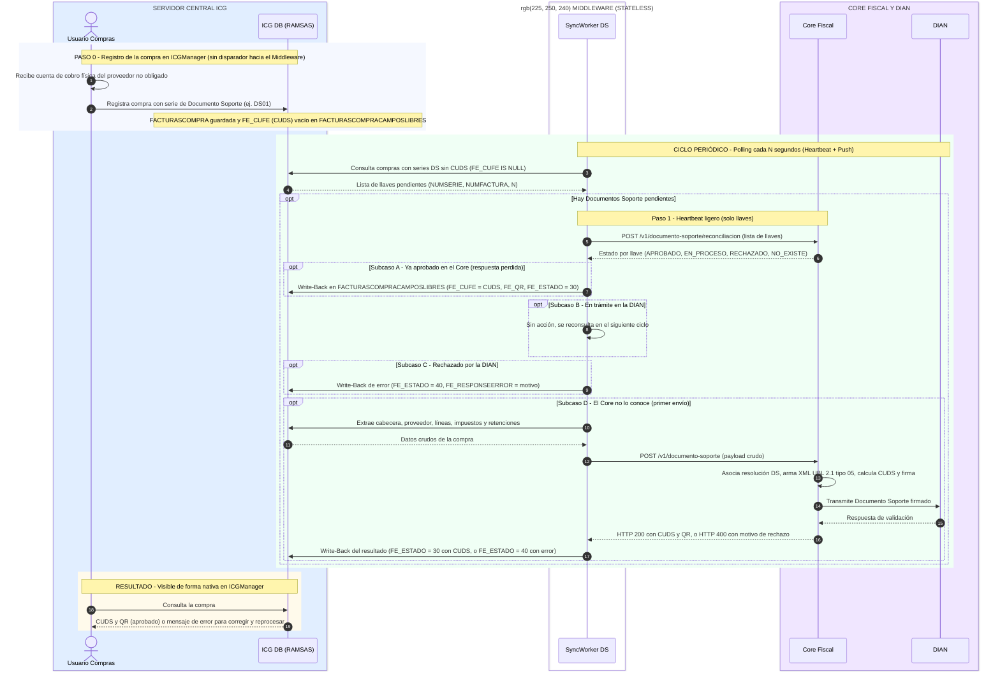

# Diagrama de Secuencia: Documento Soporte en Adquisiciones a No Obligados (DS)

Flujo de emisión del **Documento Soporte Electrónico** (tipo DIAN `05`) para compras y gastos a proveedores que **no están obligados a facturar** (personas naturales, arrendadores, servicios técnicos independientes, etc.).

La lógica es la misma de la facturación electrónica de venta, con **una sola diferencia**: no existe el Canal 1 (evento en tiempo real). El Documento Soporte **solo viaja por el ciclo periódico (polling)** del Middleware.

---

## ¿Por qué solo polling y no evento en tiempo real?

| Aspecto | Factura de Venta (Caja) | Documento Soporte (Compras) |
| :--- | :--- | :--- |
| **¿Quién lo genera?** | Cajero en Front Retail | Usuario de compras/contabilidad en ICGManager |
| **¿Hay alguien esperando el CUFE/CUDS?** | Sí, el cliente en la fila necesita el tiquete impreso con QR | No, el proveedor ya se fue con su cuenta de cobro física |
| **¿Se imprime algo en el momento?** | Sí (tiquete electrónico o de contingencia) | No |
| **Disparador** | Evento HTTP desde Front Retail + Polling de rescate | **Solo Polling** |
| **Contingencia en caliente** | Necesaria (no bloquear la caja) | No aplica (no hay usuario esperando) |
| **Dónde se instala** | Cada caja POS (`ICGFRONT`) | Servidor central (`RAMSAS` / ICGManager) |

**Conclusión:** El polling simplifica el diseño, no requiere tocar ICGManager con hooks/plugins y reutiliza al 100% el ciclo unificado (Heartbeat + Push) que ya está certificado para ventas.

---

## Diagrama de Secuencia



---

## Mapeo de Tablas en ICG (verificado en `RAMSAS`)

| Propósito | Tabla ICG | Campos Clave |
| :--- | :--- | :--- |
| Cabecera de la compra | `FACTURASCOMPRA` | `NUMSERIE`, `NUMFACTURA`, `N`, `CODPROVEEDOR`, `SUFACTURA`, `FECHA`, `TOTALBRUTO`, `TOTALIMPUESTOS`, `TOTALNETO`, `TOTALRETENCION` |
| Estado electrónico (Write-Back) | `FACTURASCOMPRACAMPOSLIBRES` | `FE_CUFE` (CUDS), `FE_QR`, `FE_ESTADO`, `FE_RESPONSEERROR`, `FE_FECHAESTADO`, `FE_FECHAVALIDACION`, `CONCEPTO_GASTO` |
| Resolución / Serie DS | `FACTURASCOMPRASERIESRESOL` | Prefijo y numeración autorizada |
| Líneas de la compra | `ALBCOMPRACAB` + `ALBCOMPRALIN` | Detalle de bienes/servicios |
| Impuestos agrupados | `FACTURASCOMPRATOT` | Bases e impuestos |
| Retenciones | `FACTURASCOMPRARET` | ReteFuente, ReteICA, ReteIVA |

> [!NOTE]
> A diferencia de `FACTURASVENTACAMPOSLIBRES`, la tabla `FACTURASCOMPRACAMPOSLIBRES` **no tiene la columna `FE_PROC`**, por lo que el Write-Back de compras solo debe tocar `FE_CUFE`, `FE_QR`, `FE_ESTADO`, `FE_RESPONSEERROR` y fechas.

---

## Consideraciones de Diseño

1. **Filtro por serie obligatorio:** El poller solo debe leer las series de Documento Soporte configuradas (ej. `DS01`). Las compras normales a proveedores que **sí** facturan electrónicamente **no** generan DS (esas van por el flujo RADIAN de la Fase 10).
2. **Reutilización del ciclo unificado:** Se aplica el mismo patrón ya certificado en ventas (Heartbeat por llaves primero, Push completo solo si `NO_EXISTE`), lo que garantiza idempotencia y evita CUDS duplicados ante cortes de red.
3. **Plazo normativo de transmisión:** La DIAN exige que el Documento Soporte se genere y transmita oportunamente respecto a la fecha de la operación. El intervalo del polling (minutos) cumple con holgura, pero **se debe validar con el área contable** el plazo exacto y si aplica la modalidad de documento soporte acumulado.
4. **Instalación:** Este ciclo se habilita únicamente en la instancia del Middleware que apunta a la base central (`RAMSAS`), no en las cajas POS.

### Configuración propuesta (`config.yaml`)

```yaml
ciclos_sincronizacion:
  documento_soporte:
    habilitado: true                 # Solo en la instalación del servidor central
    intervalo_segundos: 300          # Cada 5 minutos
    dias_hacia_atras: 15
    limite_por_ciclo: 30
    prefijos_fiscales: ["DEQ1", "DEQ2", "DEC", "GFDA", "GFDS"]  # FACTURASCOMPRASERIESRESOL.SERIEFISCAL1
    series_icg: []                   # Opcional: restringir además por NUMSERIE
```

> [!IMPORTANT]
> Verificado en `RAMSAS`: el Documento Soporte se identifica por el **prefijo fiscal** de la resolución DIAN (`SERIEFISCAL1`), no por la serie interna de compra (`NUMSERIE`). Una misma serie (ej. `A`) puede tener compras normales (`NFAC`) y documentos soporte (`DEQ2`).

### Endpoints del Core requeridos

| Endpoint | Propósito |
| :--- | :--- |
| `POST /v1/documento-soporte` | Emisión del Documento Soporte (payload crudo de ICG) |
| `POST /v1/documento-soporte/reconciliacion` | Heartbeat ligero por llaves |

