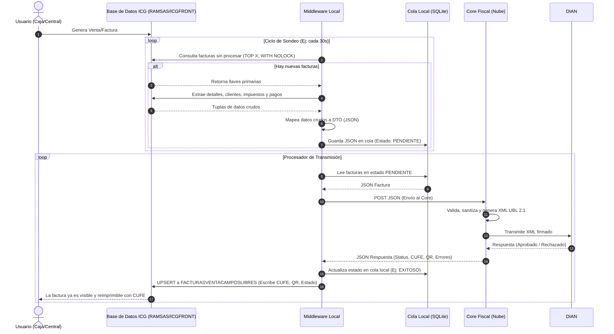

# Flujo Operativo del Middleware - Facturación Electrónica

Este documento describe la máquina de estados y el flujo lógico paso a paso del Middleware, desde que ocurre la venta en ICG hasta que se recibe y escribe el CUFE. El flujo aplica tanto para cajas individuales (`ICGFRONT`) como para la gestión central (`RAMSAS`).

## 1. El "Camino Feliz" (Happy Path)

El proceso principal asume una operación normal y conectividad estable:

1. **Evento de Venta:** El cajero finaliza una venta en la caja POS, o un usuario crea un albarán/factura en el Manager Central. ICG inserta el registro de la transacción en su base de datos nativa (`FACTURASVENTA` y tablas de detalle).
2. **Ejecución del Middleware (Polling):** Un servicio en segundo plano (el Middleware) ejecuta su ciclo de sondeo continuo (ej. cada 30 segundos). El Middleware verifica internamente mediante un *Mutex* que el ciclo anterior haya terminado para evitar sobreprocesamientos o bloqueos.
3. **Ubicación de nuevas ventas:** El Middleware ejecuta una consulta limitada (`TOP X`) en la base de datos de ICG buscando facturas que NO tengan el estado "Procesado" o cuyo campo `FE_CUFE` esté vacío en `FACTURASVENTACAMPOSLIBRES`.
4. **Cruce de información (JOINs):** Usando la llave primaria identificada (`NUMSERIE + NUMFACTURA + N`), el Middleware extrae la información requerida:
   - Fecha y Hora de Emisión.
   - Datos del Adquiriente (Cruce con `CLIENTES`).
   - Medios de pago (Cruce con `ALBVENTAPAG`).
   - Totales monetarios y Moneda.
   - Líneas de detalle y retenciones (Cruce con `ALBVENTALIN`).
   - Impuestos globales agrupados (Cruce con `FACTURASVENTATOT` e `IMPUESTOS`).
5. **Creación del JSON (Mapeo):** El Middleware toma las tuplas de SQL y las mapea al esquema DTO (Data Transfer Object) esperado por el Core Fiscal. Si la venta supera las 5 UVT y no tiene datos reales del cliente, se detiene y marca un error operativo local.
6. **Actualización de Base de Datos Temporal:** El JSON generado se inserta en una tabla o base de datos local (ej. SQLite) gestionada exclusivamente por el Middleware (Cola de Eventos) con el estado `PENDIENTE`.
7. **Envío al Core Fiscal:** Un proceso del Middleware lee los registros `PENDIENTE` de su cola local y realiza una petición HTTPS (POST) hacia el endpoint del Core Fiscal en la nube (`/api/v1/emision`).
8. **Recepción de Respuesta:** El Core Fiscal, tras comunicarse con la DIAN y generar el XML, responde al Middleware con un JSON que contiene el estado de la operación, el hash `CUFE` / `CUDE`, y la URL del código `QR`.
9. **Write-Back a ICG:** Si la operación fue exitosa, el Middleware:
   - Marca el registro como `EXITOSO` en su cola local.
   - Ejecuta un comando `UPSERT` en la base de datos de ICG (`FACTURASVENTACAMPOSLIBRES`), actualizando el `FE_ESTADO` a 30, y guardando el `FE_CUFE` y el `FE_QR`. A partir de este momento, el cajero puede visualizar o reimprimir el documento electrónico de forma nativa en ICG.

---

## Diagrama de Secuencia

